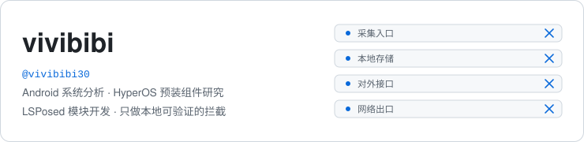
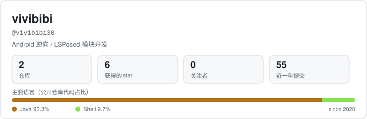
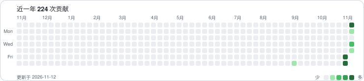

<picture>
  <source media="(prefers-color-scheme: dark)" srcset="assets/hero-dark.svg">
  
</picture>

## 在做的事

**[HyperPGuard](https://github.com/vivibibi30/hyperpguard)** — 一个可配置的应用行为开关模块（LSPosed），只在自己的设备上运行：按应用分组，分别控制网络出口、本地存储、跨应用接口、采集入口四类行为，规则支持域名 / 路径 / `类名#方法` 自定义，开关与作用域实时联动，界面跟随系统语言与深色模式，libxposed API 102（`staticScope`），GPL-3.0。

| 层面 | 控制对象 |
|---|---|
| 网络出口 | 目标进程内的 `URL` / `InetAddress` / `Socket`，按「域名后缀 + 路径」匹配 |
| 本地存储 | 指定行为库的 insert / update / delete / execSQL，按表名过滤 |
| 跨应用接口 | Provider 与回调型方法，按签名匹配 |
| 采集入口 | 应用列表、使用记录等系统查询接口 |

实现方式是静态阅读 + 真机验证：`jadx` / `apktool` 看结构、`d8` 重打包验证、`logcat` 核对命中。只处理公开 API 与自有设备上的运行时行为，不附带、不分发任何原厂代码或资源。模块内带诊断面板：注入状态、调用计数、按未命中 / 已命中分段的日志。维护按需进行。

## 项目

| 仓库 | 说明 | 状态 |
|---|---|---|
| [hyperpguard](https://github.com/vivibibi30/hyperpguard) | 可配置的应用行为开关模块（LSPosed），纯本地 | Java · GPL-3.0 |
| [ghostlock-app](https://github.com/vivibibi30/ghostlock-app) | GhostLock 一键利用（CVE-2026-43499），fork 自 [YukongA/ghostlock-app](https://github.com/YukongA/ghostlock-app) | Kotlin · fork |
| [msgbus](https://github.com/vivibibi30/msgbus) | 多个 AI 编码会话共享的纯文件消息板：一条消息一个文件，无服务端、无推送；含格式规范与 shell 参考实现 | Shell · MIT |
| [msgbus-android](https://github.com/vivibibi30/msgbus-android) | msgbus 的 Android 阅读端：root（su）/ SAF 双通道、未读游标与 `msg.sh` 共用一个 `seen/`、无 INTERNET 权限 | Java · MIT |

## 工具箱

日常用的：`jadx` · `apktool` · `aapt2` · `d8` · `apksigner` · `frida` · `logcat` · `git`

环境：Android + KernelSU + LSPosed（自用设备）。

## 概览

<picture>
  <source media="(prefers-color-scheme: dark)" srcset="assets/stats-dark.svg">
  
</picture>

<picture>
  <source media="(prefers-color-scheme: dark)" srcset="assets/contrib-dark.svg">
  
</picture>

卡片由 [`scripts/gen_cards.py`](scripts/gen_cards.py) 通过 GitHub API 生成，每天自动更新。

## 说明

- 仓库内容用于在**本人拥有完全控制权**的设备上做系统行为分析与限制，不含针对他人的攻击能力
- 模块本体不联网、不收集、不上传任何信息，配置只存在本地
- 引用他人的识别结论时会在 README 里注明来源与作者，转载或二次分发请保留来源与许可证

问题、建议或复现信息，直接开 [Issue](https://github.com/vivibibi30/hyperpguard/issues)。

## 说明

- 本页与任何设备厂商、应用开发者无隶属或合作关系；文中提及的系统与应用名称仅用于说明兼容范围，商标归各自所有者。
- 所有工具仅供在自己拥有或获授权的设备上使用，不提供绕过访问控制、破解付费功能或规避安全机制的能力。
- 仓库不含厂商代码、原厂资源或个人数据；不收集、不上传任何使用信息。
